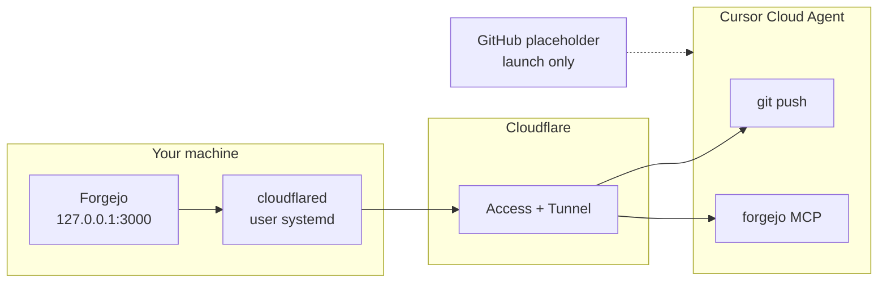

# cursor-private-git

Run **Cursor Cloud Agents** against **your Forgejo** while using a **GitHub repo only as a launch placeholder** — until [native self-hosted git support](https://forum.cursor.com/t/self-hosted-git-support/104707) exists.

## What this does

| Piece | Role |
|-------|------|
| **Forgejo** on loopback | Real git history and PRs |
| **Cloudflare Tunnel + Access** | Agents reach Forgejo without opening router ports |
| **Agent scripts** | Git credentials + three idempotent `extraHeader` values |
| **forgejo-mcp** | PRs, issues, labels, merge, statuses from the agent |
| **GitHub placeholder** | Bootstrap clone only — not canonical code |

## Architecture



## Prerequisites

- Forgejo (version in `config/forgejo.env`, default **17.0.1**)
- Cloudflare account with Zero Trust Access
- Cursor plan with Cloud Agents
- No root/sudo and no Docker required for this repo’s scripts

## Quick start

1. **Tunnel + Forgejo** — follow **[docs/SETUP.md](docs/SETUP.md)** (steps 1–11).
2. **Cursor** — set the six `FORGEJO_*` secrets; point your Environment at `.cursor/environment.json` and run a successful **Build** ([docs/CURSOR-ENVIRONMENT.md](docs/CURSOR-ENVIRONMENT.md)).
3. **Forgejo MCP for cloud agents** — Cursor Cloud Agents **do not** load repo `.cursor/mcp.json` ([capabilities](https://cursor.com/docs/cloud-agent/capabilities)); add a personal **Custom MCP** in the agent MCP dropdown (team admins: **Dashboard → Plugins & MCPs**). See [docs/SETUP.md](docs/SETUP.md) step 11.
4. **Launch** a cloud agent on this GitHub repo; work pushes to Forgejo.

## Guides

| Doc | Contents |
|-----|----------|
| [docs/SETUP.md](docs/SETUP.md) | Full ordered setup |
| [docs/TROUBLESHOOTING.md](docs/TROUBLESHOOTING.md) | Common failures |
| [docs/CURSOR-ENVIRONMENT.md](docs/CURSOR-ENVIRONMENT.md) | Builds vs `install` vs `start` |
| [docs/SETUP-CHECKLIST.md](docs/SETUP-CHECKLIST.md) | Short checklist |
| [bridge/README.md](bridge/README.md) | Tunnel scripts |
| [AGENTS.md](AGENTS.md) | Rules for agents |

## Tests (local)

```bash
bash scripts/test-agent-git-setup-headers.sh
cd mcp/forgejo-mcp && npm test
scripts/e2e-local-forgejo.sh
```

After MCP TypeScript changes:

```bash
bash scripts/sync-forgejo-mcp-dist.sh   # refresh committed dist/
```

## Constraints

- No GitHub Actions, no secrets in git, no force-push.
- Placeholders in docs only (`git.example.com`, `<TUNNEL_ID>`, etc.).

## License

This project is licensed under **GPL-3.0-only**. See [LICENSE](LICENSE) for the full text.