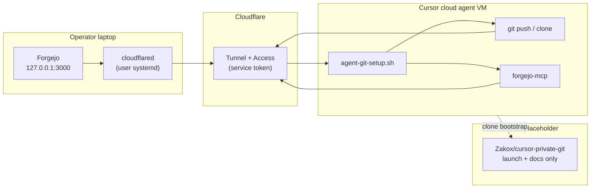

# Architecture

## Data flow

1. Developer runs Forgejo locally; tunnel exposes HTTPS hostname.
2. Cloudflare Access requires service token headers on every request.
3. Cursor agent VM receives secrets (`FORGEJO_*`, `FORGEJO_CF_ACCESS_*`).
4. Startup script configures git; MCP uses same URL, token, and Access headers.
5. GitHub repo supplies agent environment definition and documentation only.